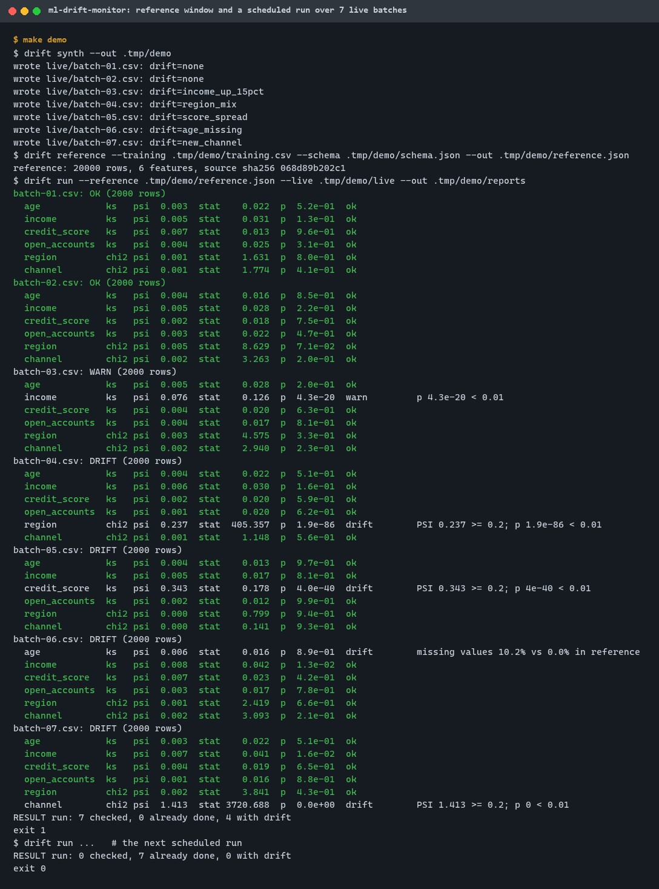
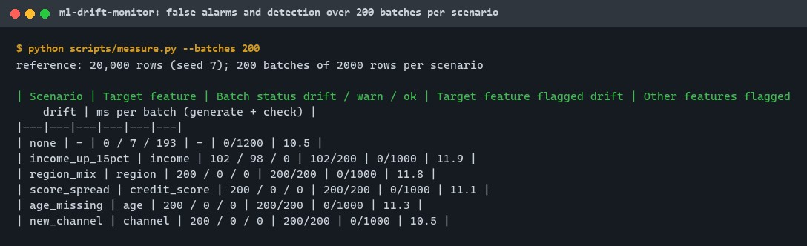
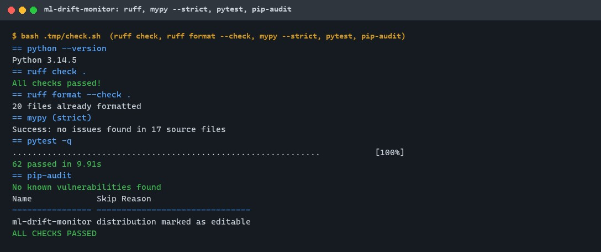
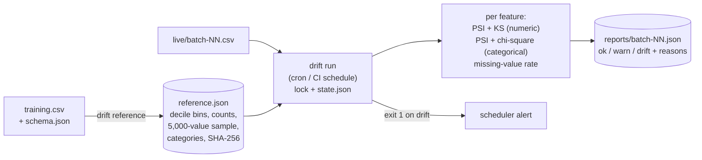
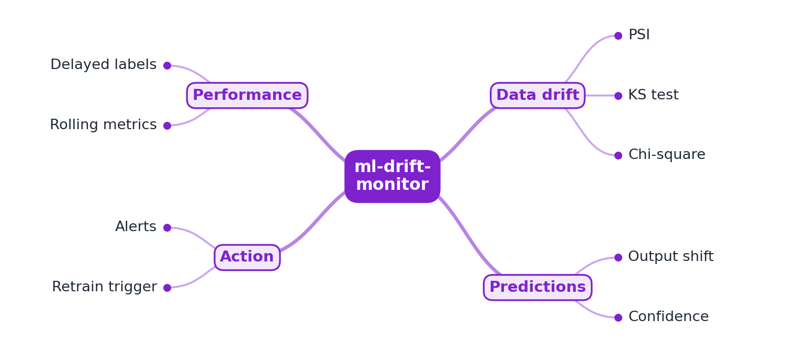

# ml-drift-monitor

[](https://github.com/EquinoxWN/ml-drift-monitor/actions/workflows/ci.yml)


> Catches a model quietly getting worse in production before your users, or your revenue, notice.

Part of my **AI and Machine Learning** list · Python

## Proof it works

A reference window is built from 20,000 synthetic training rows, then the scheduled job checks
seven live batches. The two unchanged batches pass; the region mix change, wider credit scores,
missing ages and a new sales channel are each flagged as drift on the right feature; a 15% income
rise is a warning. The next scheduled run finds nothing new to check:



Over 200 fresh batches per scenario, stable data gave 0 drift verdicts, and four of the five
injected changes were drift in 200 of 200 batches with no other feature flagged:



62 tests pass (the statistics are checked against SciPy), ruff and mypy --strict are clean, and
pip-audit finds no known vulnerabilities:



## Architecture

**What M1 runs today:**



**Full roadmap (M1 to M3):**



## How it works

_Steps 1 and 2 are built and tested (M1); the rest is on the [roadmap](#roadmap)._

1. A reference window of training data is stored for each feature.
2. Scheduled jobs compare live data with it using PSI, KS and chi-square tests.
3. Prediction distributions and confidence are tracked as well.
4. When labels arrive later, rolling accuracy is computed.
5. Metrics go to Prometheus, and alerts fire past thresholds.
6. A simulation injects drift and measures how quickly each test detects it.

In M1, `drift reference` profiles the training data (decile bins and a 5,000-value sample per
numeric feature, the top 50 categories per categorical feature) into a checksummed JSON file.
`drift run` checks every new or changed batch file once: PSI plus KS for numeric features, PSI
plus chi-square for categories, and the missing-value rate. A feature is drift when PSI ≥ 0.2, or
when the test is significant (p < 0.01) and PSI ≥ 0.1; it is a warning when only one of the two
signals fires ([ADR 0002](docs/adr/0002-psi-and-significance-together.md)).

## Who it helps

- **Who:** ML engineers and data scientists who own a model in production, and the on-call
  engineers who receive its alerts.
- **The problem:** input data drifts (a new sales channel, a broken join that blanks a column, a
  shift in customer mix) long before labels show the accuracy loss.
- **What M1 does:** a scheduled, idempotent batch check against a stored profile of the training
  data, with three standard statistics implemented in a few hundred lines of numpy and verified
  against SciPy, and a verdict per feature that says why.
- **How to use it:** write a `schema.json` for your features, run `drift reference` on your training
  data once, then call `drift run` from cron or a CI schedule on the folder where live batches land;
  exit code 1 means drift, and each batch's JSON report names the feature and the numbers.

## Tech stack

| Area | In M1 | Planned |
|---|---|---|
| Statistics | PSI, two-sample KS (asymptotic p with Stephens' correction), chi-square homogeneity, in numpy; verified against SciPy 1.18 | Wasserstein / Jensen-Shannon and Evidently comparison (M3) |
| Reference window | JSON profile: decile bins, counts, 5,000-value sample, top-50 categories, SHA-256 | |
| Scheduled job | `drift run`: new or changed batches only, lock file, atomic state, exit code; daily GitHub Actions schedule on demo data | Prometheus metrics and alerting (M3) |
| Data | Synthetic credit applications with five injectable drifts | Prediction and label tracking (M2) |
| Quality | ruff, ruff format, mypy --strict, pytest + Hypothesis (warnings are errors), pip-audit | Detection-delay simulation (M3) |

| Path | What it is |
|---|---|
| `src/ml_drift_monitor/stats.py` | PSI, KS, chi-square |
| `src/ml_drift_monitor/reference.py` | Building, saving and loading the reference window |
| `src/ml_drift_monitor/monitor.py` | Per-feature checks and the decision rule |
| `src/ml_drift_monitor/jobs.py` | The scheduled job |
| `src/ml_drift_monitor/data.py`, `synth.py`, `cli.py` | CSV reading, synthetic data, the `drift` command |
| `scripts/measure.py` | False alarms and detection over many batches (`make bench`) |

## Run it

Needs Python 3.11+ and make. Everything installs into `.venv/` and writes into `.tmp/` inside the
repository.

```bash
python -m venv .venv && . .venv/bin/activate   # Windows: .venv\Scripts\activate
make setup   # pip install -e ".[dev]"
make lint    # ruff, ruff format --check, mypy --strict
make test    # 62 tests
make audit   # pip-audit
make demo    # synthetic data, reference window, two scheduled runs
make bench   # 200 batches per scenario
```

Or step by step:

```bash
drift synth --out .tmp/demo
drift reference --training .tmp/demo/training.csv --schema .tmp/demo/schema.json --out .tmp/demo/reference.json
drift check --reference .tmp/demo/reference.json --batch .tmp/demo/live/batch-04.csv --json .tmp/b4.json
drift run --reference .tmp/demo/reference.json --live .tmp/demo/live --out .tmp/demo/reports
```

Exit codes: 0 no drift, 1 drift, 2 bad input or a run already in progress.

## Tests and results

Latest local run (full detail in [docs/results/m1.md](docs/results/m1.md)):

| Test file | Tests | What it proves |
|---|---|---|
| `tests/test_stats.py` | 14 | PSI properties (Hypothesis); KS statistic, Kolmogorov distribution and chi-square values equal SciPy's; KS p within 0.025 of SciPy's exact method |
| `tests/test_reference.py` | 9 | Decile bins, sorted sample, category cap; round trip; tampered, unknown-version and inconsistent files refused |
| `tests/test_monitor.py` | 19 | Stable batches never drift; each injected drift flagged on its own feature only; income shift caught by KS while PSI stays below 0.2; small batches "insufficient"; decision table |
| `tests/test_jobs.py` | 3 | Each batch checked once; crash keeps finished work and releases the lock; concurrent runs refused |
| `tests/test_data.py` | 11 | CSV parsing, missing values, refused input, schema validation |
| `tests/test_cli.py` | 2 | End to end through the command line, exit codes 0, 1 and 2 |
| `tests/test_calibration.py` | 4 | 0 drift in 300 stable batches; KS false-alarm rate near alpha; power for 0.5 and 0.1 standard deviation shifts |

| Check | Result |
|---|---|
| Tests | 62 passed, 0 failed (warnings are errors) |
| Lint and types | ruff clean, ruff format clean, mypy --strict: no issues in 17 files |
| Audit | pip-audit: no known vulnerabilities |
| Stable data, 200 batches | 0 drift, 7 warn, 193 ok; 0 of 1,200 feature checks flagged drift |
| Region mix, score spread, missing ages, new channel | drift in 200 of 200 batches each, on the right feature only |
| Income × 1.15 | drift in 102, warn in 98, ok in 0 of 200 batches; PSI alone (≥ 0.2) would have missed all |

The full local check passed twice. All data is synthetic; behaviour on real production data is not
measured in M1.

## Roadmap

**M1** (≈8 h)
- [x] Write `docs/rfc/0001-design.md`: problem, goals, non-goals, chosen design
- [x] A reference window of training data is stored for each feature.
- [x] Scheduled jobs compare live data with it using PSI, KS and chi-square tests.

**M2** (≈8 h)
- [ ] Prediction distributions and confidence are tracked as well.
- [ ] When labels arrive later, rolling accuracy is computed.

**M3** (≈9 h)
- [ ] Metrics go to Prometheus, and alerts fire past thresholds.
- [ ] A simulation injects drift and measures how quickly each test detects it.
- [ ] Publish the proof below with real numbers

## Proof

What this repo must show before it counts as done:

- Detection-delay chart for each simulated drift type.

| Result | Value |
|---|---|
| Detection-delay chart per drift type | Not built yet (M3). M1 measures detection rates per batch: see [Tests and results](#tests-and-results). |

## Why it matters

- **Interview angle:** 'How do you know a model is failing in production?'
- **Upstream I'd like to contribute to:** Evidently.

## Design docs

- [RFC 0001: design](docs/rfc/0001-design.md)
- [ADR 0001: record architecture decisions](docs/adr/0001-record-architecture-decisions.md)
- [ADR 0002: decide drift from PSI and a significance test together](docs/adr/0002-psi-and-significance-together.md)
- [ADR 0003: store the reference window as bins, counts and a fixed sample](docs/adr/0003-reference-as-bins-and-sample.md)
- [M1 results](docs/results/m1.md)

## Scope

This is a learning and portfolio system, not a hosted production service. Everything runs locally
on synthetic data; the scheduled GitHub workflow regenerates that data on each run.

## Security and contributing

- CSV and reference input are size-capped and validated; references carry a SHA-256 and are JSON
  only (nothing is unpickled); scheduled runs hold an exclusive lock and write atomically.
- numpy is the only runtime dependency; SciPy is used by the tests only.
- Every GitHub Action is pinned to a commit SHA; workflows run read-only, without persisted
  credentials.
- Dependabot update pull requests are paused (`open-pull-requests-limit: 0`) so the repository keeps a single `main` branch; dependencies are updated by hand and checked by the CI audit.
- Report vulnerabilities privately: see [SECURITY.md](SECURITY.md). To contribute, see [CONTRIBUTING.md](CONTRIBUTING.md).

## License

MIT, see [LICENSE](LICENSE).
